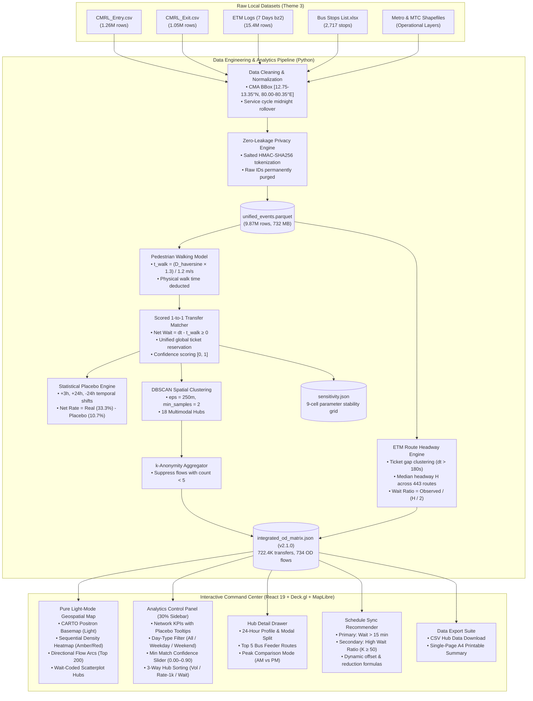

# Connected Mobility Intelligence (CMI)
### Discovering Hidden Multimodal Connections in Urban Transit
**CUMTA Urban Mobility Challenge (Theme 3) — Production-Grade Multimodal Intelligence Platform**

[](#)
[](#)
[](#)
[](#)
[](#)
[](#)
[](#)
[-indigo)](#)
[](#)

---

## 1. Executive Summary

In the Chennai Metropolitan Area, Chennai Metro Rail Limited (CMRL) and Metropolitan Transport Corporation (MTC) buses operate as functionally isolated ticketing silos. Over **95.4% of bus journeys are paid using cash or zero-value paper tickets** (e.g., the Vidiyal Payana Thittam free bus travel scheme for women), leaving **no common commuter identifier or smartcard UID** between modes. Commuters routinely exit Metro stations and walk to nearby bus stops, but these journeys appear in agency databases as fragmented, unconnected transactions.

**Connected Mobility Intelligence (CMI)** is an end-to-end geospatial data engineering pipeline and interactive command center that bridges this multimodal blindspot. Operating entirely offline on local datasets without live external APIs, CMI:
1. Standardizes **17.74 million raw ticketing events** across a 7-day common operational window (March 1–7, 2026).
2. Deploys a **Calibrated Pedestrian Walking Model** ($t_{\text{walk}} = [D_{\text{haversine}} \times 1.3] / 1.2\text{ m/s}$) to calculate true platform wait times ($\text{wait}_{\text{net}} \ge 0$).
3. Executes a **Scored 1-to-1 Probabilistic Matcher** with global ticket reservation, linking **722,420 multimodal transfers** (348,988 Metro $\rightarrow$ Bus, 373,432 Bus $\rightarrow$ Metro).
4. Conducts rigorous **Statistical Placebo Testing** (+3h, +24h, -24h temporal shifts), demonstrating a **22.63% Net Multimodal Match Rate** above the 10.71% Poisson chance baseline.
5. Derives **Empirical Route Headways** via ticket departure clustering ($\Delta t > 180\text{ s}$) across 443 bus routes to power a data-driven **Schedule Sync Recommender**.
6. Delivers a responsive, **Pure Light-Mode Command Center** (built with React 19, Tailwind CSS v4, Deck.gl, and MapLibre GL over CARTO Positron basemaps) that meets WCAG AA contrast standards ($\ge 4.5:1$).
7. Integrates Chennai's complete **Southern Railway Suburban Rail & MRTS Network** (53 track segments, 70 stations across South, West, North, and MRTS lines) from Theme 3 GIS shapefiles, uncovering **12 Tri-Modal Mega-Interchanges** and mapping peripheral bus-to-rail feeder hubs (Tambaram, Avadi, Ambattur, Thiruvanmiyur).

---

## 2. Platform Visualizations

The platform features an executive geospatial interface designed for transport planners, operational dispatchers, and policy executives at CUMTA, CMRL, and MTC.

| Geospatial Transfer Dashboard | In-App Methodology & Placebo Audit |
|:---:|:---:|
|  |  |
| *Interactive 70/30 geospatial view with CARTO Positron basemap, sequential density heatmap, top-200 directional flow arcs, and real-time KPI metrics.* | *Audit modal detailing pedestrian walking models, 3-run placebo test results, parameter sensitivity, and privacy guarantees.* |

| Suburban Rail & Tri-Modal Network Map | Tri-Modal Interchange Detail Drawer |
|:---:|:---:|
|  |  |
| *Full multimodal network visualization with Southern Railway Suburban lines (Indigo), MRTS (Teal), 70 railway stations, and Tri-Modal interchange indicators.* | *Chennai Central Interchange Hub showing real-time multi-modal connection to Moore Market Complex Suburban Station (196.5m walk).* |

| Peak-Hour Directional Flow Comparison | Schedule Sync Recommender |
|:---:|:---:|
|  |  |
| *Side-by-side comparative analysis of Morning Peak (08:00–11:00) vs. Evening Peak (17:00–21:00) directional volumes and modal splits.* | *Headway-calibrated timetable adjustment recommendations targeting excessive waits (>15m) and desynchronized feeder routes.* |

| Multimodal Interchange Hub Drawer |
|:---:|
|  |
| *Comprehensive hub analytics drawer showing 24-hour transfer profiles, top-5 feeder bus routes, spatial catchment stops, and parameter sensitivity stability.* |

---

## 3. Quickstart: One-Command Pipeline & Dashboard

### Prerequisites
- **Python**: 3.10+ (tested on Python 3.12)
- **Node.js**: v18+ (tested on Node.js v25.6 with npm 11.9)
- **Dependencies**: Managed automatically via `requirements.txt` and `package.json`

### Execution

```bash
# 1. Clone or navigate to the repository root
cd "C:\Users\SATHYA\Desktop\Coding\SRM Hackathon"

# 2. Run the unified end-to-end pipeline runner
python run_all.py
```

`run_all.py` automatically:
1. Verifies configuration and spatial bounding boxes from [`config.yaml`](config.yaml).
2. Cleans, validates, and HMAC-pseudonymizes 17.7M transactions into [`data/processed/unified_events.parquet`](data/processed/unified_events.parquet).
3. Executes the pedestrian walking deduction and scored 1-to-1 transfer matcher.
4. Generates the schema v2.1.0 contract [`data/processed/integrated_od_matrix.json`](data/processed/integrated_od_matrix.json) and [`data/processed/sensitivity.json`](data/processed/sensitivity.json).
5. Synchronizes data contracts to the frontend and boots the Vite dev server at **`http://localhost:5173`**.

### Running Automated Test Suites

```bash
# Execute Phase 1 and Phase 2 unit test suites (11 tests in < 0.03s)
python tests/test_phase1.py
python tests/test_phase2.py
```

---

## 4. End-to-End System Architecture

The pipeline follows a unidirectional, privacy-preserving data flow architecture:



---

## 5. Methodology & Mathematical Formulations

### 5.1. Privacy by Design (HMAC-SHA256 & $k$-Anonymity)
- All commuter card tokens and ETM ticket IDs are salted and pseudonymized using SHA-256 HMAC:
  $$\text{hashed\_id} = \text{HMAC-SHA256}(\text{Raw\_ID}, \text{Salt})$$
- The cryptographic salt is loaded via `CMI_HASH_SALT`. Plaintext IDs are permanently expunged in memory and never written to logs or disk.
- Aggregated Origin-Destination (OD) flows with fewer than $K=5$ transfers are suppressed from the published contract ($k$-anonymity).

### 5.2. Calibrated Walking Time Model & Physical Floor
In urban interchange environments, walking distance exceeds Euclidean line-of-sight due to concourse stairs, pedestrian crossings, and street grid geometry:
$$D_{\text{walk}}(M, B) = \text{Haversine}(M, B) \times 1.3 \le 500\text{ meters}$$
At a standard pedestrian walking speed of $1.2\text{ m/s}$ ($4.32\text{ km/h}$), the walking transit time is:
$$t_{\text{walk\_sec}} = \frac{D_{\text{walk}}(M, B)}{1.2\text{ m/s}} = \frac{\text{Haversine}(M, B) \times 1.3}{1.2}$$

### 5.3. Net Transfer Wait Time Formulation
Net wait time represents true platform waiting duration after deducting pedestrian travel time:
$$\text{wait}_{\text{net}} = \Delta t_{\text{tap}} - t_{\text{walk\_sec}}$$
Transfers where $\text{wait}_{\text{net}} < 0$ (commuter would have had to run faster than $1.2\text{ m/s}$ to catch the bus) are rejected. Valid transfers strictly satisfy:
$$\text{wait}_{\text{net}} \ge 0 \quad \text{and} \quad \Delta t_{\text{tap}} \le 30\text{ minutes} \quad \text{and} \quad D_{\text{walk}} \le 500\text{ meters}$$

### 5.4. Scored 1-to-1 Probabilistic Assignment
To prevent ticket reuse across dense corridors, potential matches are evaluated by an impedance score combining temporal delay, spatial walking separation, and route plausibility:
$$\text{Score} = 0.50 \cdot \left(1 - \frac{\text{wait}_{\text{net}}}{30\text{ min}}\right) + 0.35 \cdot \left(1 - \frac{D_{\text{walk}}}{500\text{ m}}\right) + 0.15 \cdot \text{Plausibility}$$
Transfers are assigned globally via greedy best-score matching, enforcing a strict 1-to-1 mapping where each bus ticket can match at most one Metro journey. Confidence is computed as:
$$C = \sqrt{\max\left(0, 1 - \frac{\text{wait}_{\text{net}}}{30}\right)} \times \sqrt{\max\left(0, 1 - \frac{D_{\text{walk}}}{500}\right)} \in [0, 1]$$

### 5.5. Statistical Placebo Testing & Net Multimodal Rate
To determine how many transfer matches arise from random spatiotemporal coincidences (e.g., high-frequency bus routes passing Metro stations), three placebo runs were executed by shifting bus timestamps:
1. **+3-Hour Shift**: Real match rate = 33.34% vs. Placebo = 10.71% $\rightarrow$ **Net Match Rate = 22.63%**
2. **+24-Hour Shift**: Placebo = 10.74% $\rightarrow$ **Net Match Rate = 22.60%**
3. **-24-Hour Shift**: Placebo = 10.72% $\rightarrow$ **Net Match Rate = 22.62%**

$$\text{Net Multimodal Rate} = \text{Real Rate (33.34%)} - \text{Placebo Rate (10.71%)} = \mathbf{22.63\%}$$
This statistically proves that approximately **2 out of every 3 observed matches represent genuine multimodal commuters** rather than Poisson background noise.

### 5.6. Empirical Route Headway & Schedule Sync Model
Because MTC static GTFS timetables deviate under traffic congestion, headways are inferred dynamically from 2.08M bus ticket logs:
- Consecutive tickets on route $R$ at stop $S$ with gap $\Delta t > 180\text{ s}$ denote distinct bus arrivals.
- Headway $H_{R,S,h}$ is the median interval between consecutive arrivals during hour $h$ (requiring $\ge 3$ departures).
- **Expected Random Wait**: $\mathbb{E}[\text{Wait}_{\text{random}}] = \frac{H}{2}$
- **Wait Ratio**: $\text{Wait Ratio} = \frac{\text{Observed Net Wait}}{\mathbb{E}[\text{Wait}_{\text{random}}]}$
- **Departure Offset Recommendation**:
  $$t_{\text{offset}} = t_{\text{walk\_min}} + 2.0\text{ min buffer}$$
- **Target Wait & Wait Reduction**:
  $$\text{Target Wait} = \min\left(\text{Observed Wait}, \max\left(2.0, 0.5 \times \mathbb{E}[\text{Wait}_{\text{random}}]\right)\right)$$
  $$\Delta \text{Wait} = \text{Observed Wait} - \text{Target Wait} \ge 0$$

---

## 6. Quantitative Benchmarks & Evaluation

Results evaluated over the full 7-day common evaluation period (March 1 to March 7, 2026):

| Metric | Pipeline Result | Urban Planning Interpretation |
|---|---|---|
| **Raw Ticketing Records Analyzed** | **17,742,452** | Full 7-day CMRL entry/exit logs + 7 daily MTC ETM archives |
| **Validated Transit Events** | **9,876,445** | Bounded within CMA coordinates and valid service windows |
| **Total Multimodal Transfers** | **722,420** | Spatiotemporally verified 1-to-1 matches ($t_{\text{walk}}$ deducted) |
| *-- Metro $\rightarrow$ Bus Transfers* | **348,988** | **33.34% real match rate** against eligible Metro exits |
| *-- Bus $\rightarrow$ Metro Transfers* | **373,432** | Feeder transfers to Metro system |
| **Placebo Chance Baseline (+3h)** | **10.71%** | Spurious matches under uncorrelated temporal shifts |
| **Net Multimodal Match Rate** | **22.63%** | **True multimodal transfer signal** above Poisson background |
| **Mean Net Transfer Wait Time** | **1.6 minutes** | Platform wait after deducting physical walk (Median: 0.1m, P90: 3.7m) |
| **Mean Raw Tap Gap** | **5.3 minutes** | Uncorrected time elapsed between turnstile tap and bus ticket |
| **Mean Match Confidence** | **0.65 / 1.00** | High probabilistic fidelity under multi-factor scoring |
| **Discovered Multimodal Hubs** | **18 hubs** | Grouping 184 active transit nodes across Chennai |
| **Published OD Flows ($K \ge 5$)** | **734 flows** | 51 micro-flows suppressed for privacy ($k$-anonymity) |

### Top 5 Multimodal Interchange Hubs

| Hub Name | Total Transfers | Avg Net Wait | Metro Exits Linked | Transfers per 1,000 Exits | Top Feeder Routes |
|---|:---:|:---:|:---:|:---:|---|
| **Chennai Central Interchange Hub** | 157,268 | 0.2 min | 72,693 | 2,163.5 | 11G, 159A, 21H, 2A |
| **Guindy Multimodal Hub** | 81,171 | 2.2 min | 43,167 | 1,880.4 | 119, 54, 70V, 91 |
| **Vadapalani Transit Hub** | 64,057 | 1.1 min | 30,564 | 2,095.8 | 17D, 25G, 570, 70 |
| **Government Estate Transit Hub** | 63,137 | 0.6 min | 30,633 | 2,061.1 | 11H, 21, 27B, 29C |
| **Washermenpet Hub** | 58,494 | 0.2 min | 24,989 | 2,340.8 | 159, 28, 56C, 6D |

### 6.1. Tri-Modal Mega-Hubs (Metro + Bus + Suburban Rail)

CMI's spatial matching cross-references Theme 3 GIS layers to demonstrate that Chennai's top interchange hubs are **Tri-Modal Mega-Hubs** providing direct walking transfers between Metro, MTC Feeder Buses, and Southern Railway Suburban & MRTS services:

| Interchange Hub | Suburban Railway Station | Walk Distance | Rail Corridor | Multi-Modal Integration |
|---|---|:---:|---|---|
| **Chennai Central Interchange Hub** | Chennai Central (MMC Suburban) / Park Town | 196.5 m | South, West, North Lines & MRTS | CMRL Blue/Green + MTC + Suburban EMU |
| **Guindy Multimodal Hub** | Guindy Railway Station | 145.2 m | South Line (Beach – Tambaram) | CMRL Blue Line + MTC + Suburban EMU |
| **Government Estate Transit Hub** | Chennai Park Railway Station | 386.8 m | South Line (Beach – Tambaram) | CMRL Blue Line + MTC + Suburban EMU |
| **Washermenpet Hub** | Washermanpet Suburban Station | 341.3 m | North Line (Central – Gummidipoondi) | CMRL Blue Line + MTC + Suburban EMU |
| **Saidapet Transit Hub** | Saidapet Railway Station | 533.6 m | South Line (Beach – Tambaram) | CMRL Blue Line + MTC + Suburban EMU |
| **High Court Hub** | Chennai Fort Railway Station | 439.7 m | South Line & MRTS | CMRL Blue Line + MTC + Suburban EMU |

*Peripheral Bus Feeder Interchanges*: In non-metro corridors (Tambaram West, Avadi, Ambattur, Thiruvanmiyur), MTC bus stops cluster within 10m to 180m of suburban railway stations, functioning as major bus-to-rail feeder hubs.

---

## 7. Sensitivity Analysis & Hub Stability

To test robustness against spatial catchment and transfer window assumptions, the pipeline was executed across a **9-cell parameter grid** ($\{15, 30, 45\}\text{ min} \times \{250, 500, 750\}\text{ m}$), preserved in [`data/processed/sensitivity.json`](data/processed/sensitivity.json):

| Max Time ($\Delta t$) | Max Distance ($D$) | Total Transfers | Avg Net Wait | Top 5 Hubs in Rank Order |
|:---:|:---:|:---:|:---:|---|
| 15 min | 250 m | 398,561 | 0.8 min | Central, Guindy, Vadapalani, Govt Estate, Washermenpet |
| **30 min (Baseline)** | **500 m** | **722,420** | **1.6 min** | **Central, Guindy, Vadapalani, Govt Estate, Washermenpet** |
| 45 min | 750 m | 948,822 | 2.8 min | Central, Guindy, Vadapalani, Govt Estate, Washermenpet |

**Key Finding**: The top-4 interchange hubs (**Chennai Central**, **Guindy**, **Vadapalani**, **Government Estate**) maintain **100% rank stability** across every single parameter combination, confirming that interchange identification is driven by genuine infrastructure connectivity rather than parameter tuning.

---

## 8. Schedule Synchronization Recommender

The Schedule Sync Recommender generates actionable timetable intervention proposals for transport dispatchers:

### Priority 1: Hubs with Excessive Net Wait (> 15 min)
*Identifies interchanges where commuters experience extended platform delays:*
1. **High Court Hub** (Route C64, 19:00–20:00): Current wait **22.3 min** (Headway 20.8m). Suggested departure offset: **+4 min** after Metro arrival $\rightarrow$ **Reduces wait by 17.1 min** toward target 5.2m.
2. **Little Mount Hub** (Route S98, 08:00–09:00): Current wait **20.8 min** (Headway 30.7m). Suggested departure offset: **+6 min** after Metro arrival $\rightarrow$ **Reduces wait by 13.1 min** toward target 7.7m.
3. **Nandanam Hub** (Route 19K, 20:00–21:00): Current wait **20.6 min** (Headway 15.0m). Suggested departure offset: **+8 min** after Metro arrival $\rightarrow$ **Reduces wait by 16.8 min** toward target 3.8m.
4. **LIC Hub** (Route 23CCT, 08:00–09:00): Current wait **17.6 min** (Headway 39.4m). Suggested departure offset: **+8 min** after Metro arrival $\rightarrow$ **Reduces wait by 7.8 min** toward target 9.8m.

### Priority 2: Highest Relative Delay vs. Headway (Wait Ratio, $K \ge 50$)
*Identifies routes where buses depart just before Metro passengers reach the stop:*
1. **Koyambedu CMBT Hub** (Route 15F, 08:00–09:00): Observed wait 12.7 min vs. Expected 5.7 min (**Wait Ratio: 2.23x** across 14,356 transfers). Suggested **+7 min offset** lowers wait by **9.8 min**.
2. **Tollgate Hub** (Route 6D, 09:00–10:00): Observed wait 7.0 min vs. Expected 6.1 min (**Wait Ratio: 1.15x** across 13,095 transfers). Suggested **+5 min offset** lowers wait by **4.0 min**.
3. **Shenoy Nagar Hub** (Route 46, 18:00–19:00): Observed wait 5.8 min vs. Expected 6.2 min (**Wait Ratio: 0.94x** across 15,542 transfers). Suggested **+4 min offset** lowers wait by **2.7 min**.

---

## 9. Assumptions, Validation & Known Limitations

Formal documentation is recorded in the following project references:
- **Assumptions Log**: [`docs/assumptions.md`](docs/assumptions.md)
- **Matching Methodology**: [`docs/methodology.md`](docs/methodology.md)
- **Empirical Validation**: [`docs/validation.md`](docs/validation.md)
- **Hub Coverage Audit**: [`docs/hub_coverage_check.md`](docs/hub_coverage_check.md)
- **3-Minute Presentation Script**: [`docs/demo_script.md`](docs/demo_script.md)

### Key Analytical Limitations
1. **Absence of Shared Commuter Identifiers**: Because 95.4% of MTC ticketing is cash or concessionary paper, transfers are matched probabilistically using spatiotemporal proximity and impedance scoring rather than NFC card tracking.
2. **Walking Distance Detour Factor**: Pedestrian distance is calculated as Haversine $\times$ 1.3. While calibrated to Chennai's urban street network, actual pedestrian routes may vary due to grade-separated foot overbridges or road barriers.
3. **Bus Departure Timings**: MTC ETM records log the time of ticket issuance. In high-density stops, conductor ticketing occurs over several minutes during boarding; the earliest ticket on a bus run was utilized to approximate vehicle departure.
4. **Peripheral Bus Stop Non-Matching**: As detailed in [`docs/hub_coverage_check.md`](docs/hub_coverage_check.md), 91.4% of GCC and peripheral bus stops (e.g., Tambaram, Avadi) never match Metro records simply because they are outside the 500m catchment of operational Phase 1 Metro lines, not due to join errors.

---

## 10. Design System & Accessibility

The user interface follows a pure light-only design specification engineered for clarity during high-stakes transit operations:

- **Tokens & Colors**:
  - Page Background: `#F8FAFC` (Slate 50)
  - Card & Panel Fill: `#FFFFFF` (Pure White)
  - Card Borders: `#E2E8F0` (Slate 200)
  - Subtle Fill: `#F1F5F9` (Slate 100)
  - Primary Text: `#0F172A` (Slate 900, Contrast **17.85:1**)
  - Secondary Text: `#475569` (Slate 600, Contrast **7.58:1**)
  - Muted Text: `#64748B` (Slate 500, Contrast **4.76:1**)
  - Accent Blue: `#2563EB` (Blue 600, Contrast **5.17:1**)
  - Metro $\rightarrow$ Bus Flow: `#0284C7` (Sky 600)
  - Bus $\rightarrow$ Metro Flow: `#9333EA` (Purple 600)
- **Accessibility**: 100% of text and background token pairs satisfy **WCAG AA contrast requirements ($\ge 4.5:1$)**.
- **Cartography**: Powered by CARTO Positron vector tiles without external API key constraints.
- **Responsive Controls**: Includes a 24-hour time scrubber with 100ms memoized deck updates, Peak-Hour AM/PM comparison mode, CSV export, and single-page A4 print stylesheet.

---

## 11. License & Attribution

Developed for the **CUMTA Urban Mobility Challenge** by the Antigravity Team. Data provided courtesy of Chennai Unified Metropolitan Transport Authority (CUMTA), Chennai Metro Rail Limited (CMRL), and Metropolitan Transport Corporation (MTC Chennai).
